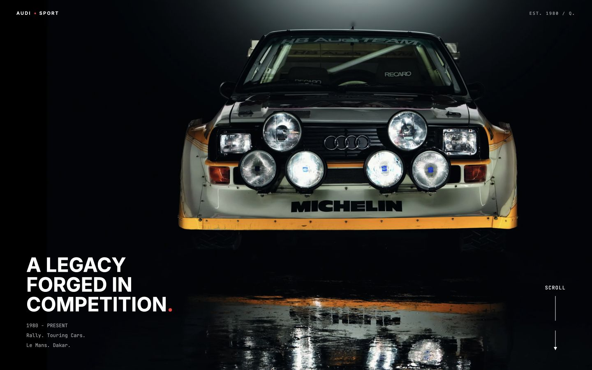
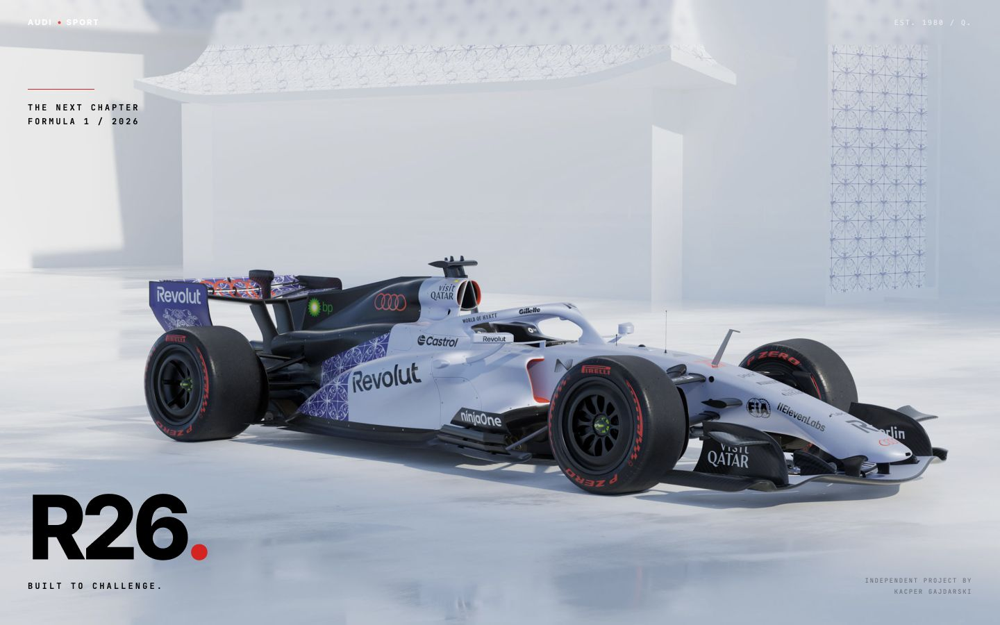

# AudiSport

AudiSport is a live, independent portfolio showcase exploring Audi's motorsport
history through an animation-led, single-page experience.

**Live site:** [audisport.kacpergajdarski.com](https://audisport.kacpergajdarski.com/)

This is an independent portfolio project. It is not affiliated with or endorsed
by Audi AG.

## Desktop preview





## Project status

AudiSport is live in production and included in the creator's main portfolio.
The experience intentionally uses continuous motion, scroll-linked storytelling,
animated text reveals, and smooth scrolling as core design decisions.

Implemented features include:

- Responsive mobile, tablet, and desktop layouts.
- A full-viewport hero with responsive, locally served WebP sources and a JPEG
  fallback.
- A pinned horizontal motorsport timeline on desktop (`1024px` and wider), with
  measured travel based on the track's rendered width.
- A vertical, document-flow timeline on mobile and tablet, with
  viewport-triggered chapter reveals.
- An adaptive fixed header that samples the content beneath it and switches
  contrast over light and dark sections.
- GSAP and ScrollTrigger choreography for the hero, editorial sections, text
  reveals, story chapters, and Formula 1 finale.
- Lenis smooth scrolling on desktop devices with a fine pointer, connected to
  GSAP's ticker and ScrollTrigger lifecycle.
- Static Vite production output, deployment metadata, `robots.txt`, and a
  one-page XML sitemap.

## Technology stack

| Area              | Technologies                              |
| ----------------- | ----------------------------------------- |
| UI                | React 19, TypeScript, Tailwind CSS 4      |
| Application shell | Vite SPA                                  |
| Motion            | GSAP, `@gsap/react`, ScrollTrigger, Lenis |
| Tooling           | pnpm, ESLint, Prettier, Vitest            |

## Architecture and interaction design

```text
Vite single-page entry
  ├─ global metadata and styles
  ├─ adaptive fixed header
  └─ page composition
       ├─ animated ring loader
       ├─ sticky, scaled hero
       ├─ scroll-revealed editorial statement
       └─ responsive motorsport timeline
            ├─ typed chapter data
            ├─ isolated reveal/scroll animation hook
            ├─ desktop: pinned horizontal track
            └─ mobile/tablet: vertical panels
```

Content is held in typed configuration modules close to the components, keeping
repeated statistics, statements, and timeline chapters consistent. The hero,
philosophy, story panels, and animation orchestration live in focused modules
instead of one page component.

GSAP scopes component animations through `useGSAP`. A `gsap.matchMedia()` split
creates the horizontal desktop sequence and the vertical mobile/tablet sequence,
then reverts those branches during cleanup. On supported mobile Safari versions,
the hero can use a native scroll-driven CSS animation; GSAP provides the other
hero path. Lenis is connected to GSAP's ticker on eligible desktop devices and
explicitly disconnected on unmount.

The adaptive header avoids a hard-coded scroll threshold. It samples three
points beneath itself with `elementsFromPoint`, reads `data-header-theme`
markers, and batches scroll and resize work through `requestAnimationFrame`.

## Responsive design and accessibility

- Tailwind breakpoints reshape the hero statistics and editorial sections.
- The story changes from a pinned horizontal track at `1024px` to normal
  vertical document flow below that breakpoint.
- Timeline images include descriptive alternative text.
- The brand mark is a semantic link, timeline panels use articles and headings,
  and decorative imagery and oversized year treatments are hidden from
  assistive technology where appropriate.

The animation-led experience and its continuous motion are intentional parts of
the project rather than incomplete work. Accessibility has not been certified
or comprehensively audited; see the known limitations below for the checks that
remain outstanding.

## Performance notes

- The production output is a static Vite bundle with no router or server
  runtime.
- The hero uses responsive 1600px and 2560px WebP sources with a JPEG fallback.
- Local PP Neue Montreal fonts use `font-display: swap`.
- Scroll listeners are passive and header updates are animation-frame batched.
- Story imagery is lazy-loaded and decoded asynchronously in the rendered
  chapters, with a desktop preload pass to warm the browser cache.

Image and font delivery still have optimisation opportunities. Timeline
chapters use one WebP size each rather than responsive `srcset` variants, ten OTF
font files are committed, and Google Font imports remain alongside the local
font family. Font subsetting, removing unused font files or requests, and
responsive timeline image variants are possible follow-ups.

## Getting started

Requirements: Node.js and pnpm.

```bash
pnpm install
pnpm dev
```

The development server runs on `http://localhost:3000`.

Create a production bundle and preview it locally:

```bash
pnpm build
pnpm preview
```

## Testing and code quality

```bash
pnpm build
pnpm test
pnpm lint
pnpm format
pnpm check
```

Vitest and Testing Library are installed, but no automated test files are
committed. No CI workflow is currently committed. The exact results of the
commands above can change as the repository evolves and should be confirmed by
running them locally rather than inferred from configuration alone.

## Deployment

The production site is deployed at
[https://audisport.kacpergajdarski.com/](https://audisport.kacpergajdarski.com/).
Vite generates the static bundle in `dist`, which is served by Vercel without a
custom server runtime.

Both the production page and its
[XML sitemap](https://audisport.kacpergajdarski.com/sitemap.xml) returned HTTP
200 during the documentation audit on 18 October 2026. `robots.txt` references
that sitemap, which lists the canonical production URL.

## Known limitations

- No automated tests or CI workflow are committed.
- Motorsport statistics and editorial claims do not include source citations in
  the repository and should not be treated as a referenced historical record.
- Accessibility checks for heading hierarchy, contrast, zoom, keyboard focus
  order, and screen-reader output have not been comprehensively completed.
- Timeline images and the committed font set have the optimisation opportunities
  described above.
- Responsive behavior is implemented for desktop, tablet, and mobile, but no
  automated cross-browser or device regression suite is committed.

## Technical decisions and trade-offs

- **Two story modes:** separate desktop-horizontal and mobile/tablet-vertical
  behavior keeps the interaction appropriate to each layout, while increasing
  the number of paths that require manual testing.
- **Measured scroll distance:** deriving movement from `scrollWidth` supports
  content changes better than a fixed pixel distance, while still requiring
  careful refresh behavior after assets and fonts load.
- **Theme markers:** declarative `data-header-theme` regions keep contrast logic
  out of individual sections, though DOM sampling on scroll remains work that
  should be profiled on lower-powered devices.
- **Animation-led presentation:** GSAP provides precise choreography, and the
  continuous motion is a deliberate part of the portfolio concept.
