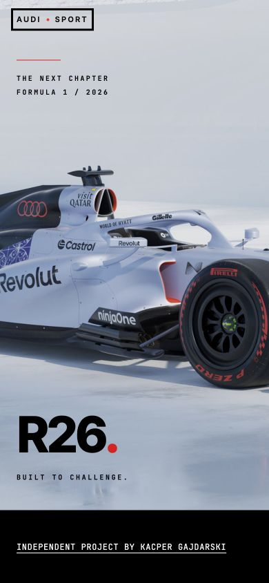
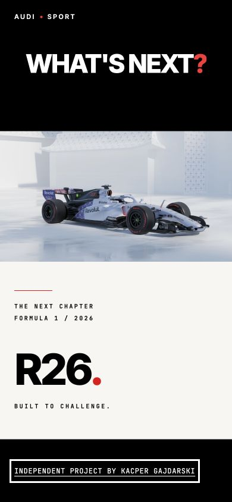
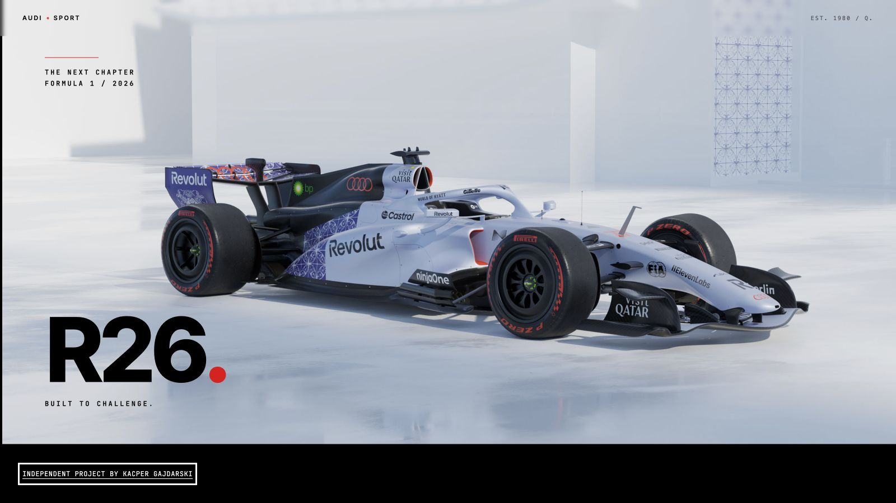
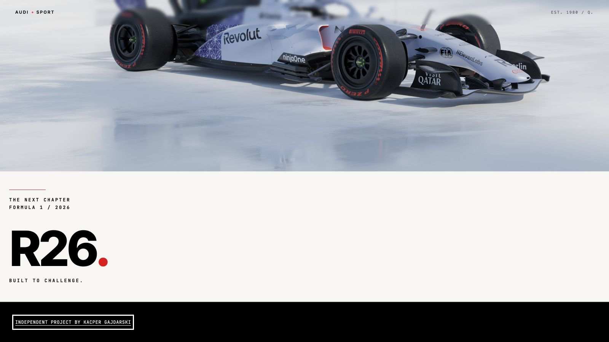

# AudiSport browser accessibility audit

Verified on 3 November 2026 in the Codex in-app browser on macOS. Tested the
local workspace at `http://localhost:3000` and rechecked the final production
bundle at `http://127.0.0.1:4173`. This does not verify the deployed website.

The workspace already contained the reduced-motion branches, footer relocation,
focus styles, and an earlier README audit when this pass began. Those changes
were preserved and independently checked.

## Reproduced and fixed in this pass

1. **White header and focus outline over the pale mobile finale.** The faded-out
   “What's next?” layer still participated in `elementsFromPoint`, making the
   header choose the dark-section theme. Made this decorative layer ignore
   pointer hit testing. Its underlying masks still supply the dark theme before
   the image is revealed. The image now has its own light theme marker, with
   dark markers on the masks, so the static reduced-motion image also receives
   a contrasting header.
2. **Stale header theme after keyboard jumps.** The scrubbed finale can reveal its
   light overlay after the last scroll event. The header now observes style/theme
   changes on themed elements and batches another sample through its existing
   animation-frame scheduler. A resize observer also handles layout shifts from
   lazy-loaded images beneath a stationary header. Both observers disconnect on
   cleanup.
3. **Finale label overlapped by the fixed header at the footer.** Increased the
   label's top clearance. At 390 × 844, the final label starts at approximately
   104px, below the header's 57px bottom edge, with the footer visible.

## Verification matrix

| Viewport   | Motion        | Verified result                                                                                                                   |
| ---------- | ------------- | --------------------------------------------------------------------------------------------------------------------------------- |
| 1600 × 900 | No preference | Pinned horizontal timeline; Page Down reaches intro, five historical chapters, R26 and footer.                                    |
| 390 × 844  | No preference | Vertical timeline; Page Down reaches every chapter and footer; corrected header and focus outline are black over the pale finale. |
| 1600 × 900 | Reduce        | Vertical timeline, zero pin spacers, no transparent story copy, footer reachable by Tab and Page Down.                            |
| 390 × 844  | Reduce        | Static hero and finale; full “What's next?” heading, image and R26 copy remain in flow; zero horizontal page overflow.            |

Reduced motion was enabled using macOS Accessibility → Motion and verified in
the page with `matchMedia('(prefers-reduced-motion: reduce)')`. The original
setting (off) was restored after testing.

Additional checks:

- Tab reaches the brand link, then the footer author link; Shift+Tab returns to
  the brand. Both links have visible focus outlines.
- Enter on the brand returns to the top. Enter on the author link opens the
  creator's portfolio. Space scrolls the page.
- Page Up from the footer preserves focus on its link; Home returns to the top,
  and End reaches the finale/footer. Arrow Up scrolls backward.
- Enabling reduced motion on an already loaded page removes animated story
  styles; disabling it on wide desktop restores one pin spacer without reload.
- Resizing between desktop and mobile switches the timeline layout. No horizontal
  page overflow was observed at either tested size.
- A fresh reduced-motion load skips the loader, leaves the hero transform as
  `none`, and does not enable Lenis.
- The final production build was rechecked for footer keyboard focus in all four
  viewport/motion combinations and for the corrected finale header behavior.

Validation commands passed: `pnpm build`, `pnpm exec tsc --noEmit`, `pnpm lint`,
and `git diff --check`. No automated browser suite was added.

## Evidence

## Scope limits

Mobile means a narrow real-browser viewport, not a physical phone or touch-device
emulation. This pass does not certify screen-reader behavior, contrast throughout
the site, zoom/reflow, Safari's native scroll-animation path, or other browsers.
The normal-motion loader temporarily blocks scrolling during its introduction;
the reduced-motion path bypasses it.

## Follow-up presentation tweaks

- The philosophy and purpose blocks share a row beneath the statement at
  `640px`–`1535px`, with aligned headings. Smaller screens retain stacked blocks;
  wide desktop retains the existing columns around the statement.
- “Our Purpose” uses end-aligned heading and body text, with its final wrapped
  line aligned to the same edge.
- The animated R26 finale now holds for an extra viewport of scrolling before
  the footer enters. The static reduced-motion finale is unchanged.

The two-column layout was visually checked at 1024 × 1000 and mobile stacking
at 390 × 844. The subsequent text-alignment adjustment passed the production build.
